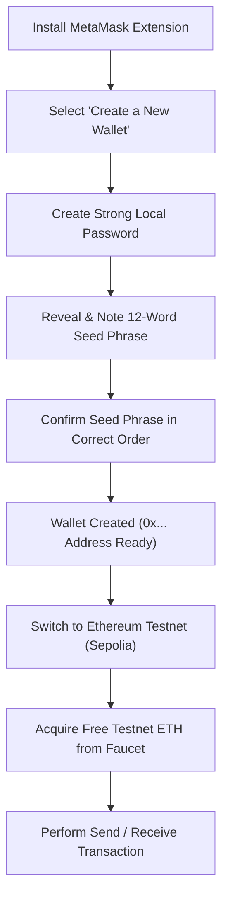

# Experiment: Create Your Own Wallet Using MetaMask for Crypto Transactions

**Course:** Laboratory Practice - III (BE Computer Engineering - SPPU 2019 Pattern)  
**Group:** Group C (Blockchain Technology)  
**Assignment No:** BT2 (and BT1)  
**Reference:** [Lab practice - III Lab Manual.pdf](file:///c:/Users/HEllo/practical/Lab%20practice%20-%20III%20Lab%20Manual.pdf) (Pages 123–137)

---

## 1. Objective & Overview

- **Objective:** To install the MetaMask browser extension, create a non-custodial cryptographic Ethereum wallet, securely store the Secret Recovery Phrase (seed phrase), understand public/private key pairs, and execute test cryptocurrency transactions.
- **Tools Required:** Web Browser (Google Chrome, Brave, Firefox, or Edge) with Internet access. No programming code required.

---

## 2. Theoretical Background

### What is a Crypto Wallet?
A cryptocurrency wallet does not physically "store" digital coins. Instead, coins exist as ledger entries permanently recorded on the blockchain network. A wallet stores:
1. **Private Key:** A secret 256-bit number that grants authorization to sign transactions and transfer funds.
2. **Public Key / Address:** A 40-character hexadecimal address (prefixed with `0x`) derived mathematically from the private key via ECDSA (`secp256k1`) and Keccak-256. This address is public and shared with others to receive funds.

### Hot Wallet vs. Cold Wallet (Manual Page 136)
| Feature | Hot Wallet (e.g., MetaMask) | Cold Wallet (e.g., Ledger, Trezor) |
| :--- | :--- | :--- |
| **Connectivity** | Connected to the internet (Browser extension/app) | Completely offline physical hardware |
| **Convenience** | Instant interaction with DApps & smart contracts | Requires manual physical USB connection |
| **Security Risk** | Vulnerable to phishing and browser malware | Immune to online hacking vectors |
| **Cost** | Free to install | Paid hardware device ($60 – $200) |

---

## 3. Step-by-Step Procedure to Create a Wallet

### Step 1: Install the MetaMask Browser Extension (Manual Page 126–128)
1. Open your browser (Google Chrome, Brave, or Firefox).
2. Visit the official website: [https://metamask.io/download/](https://metamask.io/download/) or open the **Chrome Web Store**.
3. Search for **MetaMask** (verify it is offered by `metamask.io` with millions of downloads).
4. Click **Add to Chrome** -> confirm by clicking **Add extension**.
5. Once downloaded, the MetaMask Fox icon will appear in your browser's extension toolbar. Pin it to your toolbar for easy access.

---

### Step 2: Initialize Wallet Setup (Manual Page 128)
1. Click the MetaMask fox icon. A "Welcome to MetaMask" tab will launch.
2. Agree to MetaMask's Terms of Use.
3. You will see two options:
   - *Import an existing wallet* (used if you already have a 12-word recovery phrase).
   - **Create a new wallet** -> **Click this button**.
4. Choose whether to share anonymized usage analytics with MetaMask developers.

---

### Step 3: Create a Local Password (Manual Page 129)
1. Set a strong password (minimum 8 characters, alphanumeric + symbols).
2. Confirm your password.
3. Tick the checkbox acknowledging that MetaMask cannot recover this local password if lost.
4. Click **Create a new wallet**.

> [!NOTE]
> This password only encrypts and unlocks the wallet extension on your specific local computer. It is **not** your private key.

---

### Step 4: Secure the Secret Recovery Phrase (Seed Phrase) (Manual Page 129–130)
1. MetaMask will display a video explaining the Secret Recovery Phrase. Click **Secure my wallet (recommended)**.
2. You will see a locked box: **Reveal Secret Recovery Phrase**. Click on it.
3. A sequence of **12 English words** will appear in numbered order (e.g., `1. wool  2. thought  3. awful  4. better ...`).

> [!CAUTION]
> **Why is this 12-word phrase critical?**
> - The 12-word seed phrase (BIP-39 standard) is the master mathematical seed from which all your private keys and addresses are generated.
> - **Anyone who knows these 12 words has full ownership of your wallet and can steal all assets.**
> - Never save it as a plaintext file, email it, or take a screenshot. Write it down on paper and store it securely offline.

---

### Step 5: Verify the Secret Recovery Phrase (Manual Page 130)
1. Click **Next**.
2. MetaMask will ask you to fill in missing words from your phrase (e.g., Word #3, Word #7, Word #10) to confirm you wrote it down correctly.
3. Click **Confirm**.
4. A celebratory screen appears: *"Wallet creation successful!"*. Click **Got it!** -> **Next** -> **Done**.

---

### Step 6: View Your Public Ethereum Address (Manual Page 131)
1. You are now inside your wallet dashboard.
2. At the top under **Account 1**, you will see your public address:  
   `0x...` (e.g., `0x5B38Da6a701c568545dCfcB03FcB875f56beddC4`).
3. Hover over the address and click **Copy to clipboard**.
4. This address is completely safe to share publicly with anyone who wants to send you Ether or tokens.

---

## 4. Performing Crypto Transactions (Without Real Money)

To practice transactions during practical exams without spending real money, use an **Ethereum Testnet** (e.g., Sepolia Testnet).

### Step 7: Enable Test Networks in MetaMask
1. In the top-left corner of the MetaMask popup, click the **Network dropdown** (defaults to *Ethereum Mainnet*).
2. Toggle the switch: **Show test networks**.
3. Select **Sepolia** (or **Holesky**).
4. Notice your currency balance shows `0 SepoliaETH`.

---

### Step 8: Get Free Testnet Ether from a Faucet
1. Copy your public address (`0x...`).
2. Open a public Sepolia Faucet in your browser:
   - [https://sepoliafaucet.com/](https://sepoliafaucet.com/) or [https://cloud.google.com/application/web3/faucet/ethereum/sepolia](https://cloud.google.com/application/web3/faucet/ethereum/sepolia)
3. Paste your wallet address into the faucet input box and click **Receive 0.5 SepoliaETH**.
4. Within 15–30 seconds, your MetaMask balance will update from `0 ETH` to `0.5 ETH`.

---

### Step 9: Send a Crypto Transaction (Manual Page 132)
1. Open MetaMask and click the blue **Send** button.
2. In the recipient input, paste the destination Ethereum address (you can ask a classmate for their address, or create a second account in your own MetaMask: click *Account icon* -> *Add account*).
3. **Amount:** Enter the amount to transfer (e.g., `0.05 SepoliaETH`).
4. **Gas Fee Estimation:** MetaMask will display the estimated network transaction fee (Gas):
   - **Gas Limit:** Default `21,000` units for simple transfers.
   - **Gas Price:** Displayed in Gwei ($10^{-9}\text{ ETH}$).
   - **Options:** *Market*, *Aggressive*, or *Low*.
5. Click **Next** -> Review transaction details (Amount + Max Gas Fee).
6. Click **Confirm**.

---

### Step 10: Inspect Transaction Receipt & Status (Manual Page 132)
1. Click on the **Activity** tab in MetaMask.
2. The transaction will show as **Pending**, then transition to **Confirmed**.
3. Click on the confirmed transaction to inspect details:
   - **Status:** Confirmed
   - **Transaction Hash (TxID):** A unique 64-character hexadecimal receipt proof.
   - **Gas Used:** Exactly 21,000 units.
   - **Total Spent:** Transferred amount + Gas Fee.
4. Click **View on block explorer** to open [Sepolia Etherscan](https://sepolia.etherscan.io/) and inspect the immutable blockchain ledger entry.

---

## 5. Connecting MetaMask to Decentralized Apps (DApps) (Manual Page 133)

To interact with smart contracts (like the Bank or Student contract in Remix IDE):
1. Open [https://remix.ethereum.org](https://remix.ethereum.org).
2. Navigate to **Deploy & Run Transactions**.
3. Change the **ENVIRONMENT** dropdown from *Remix VM* to **Injected Provider - MetaMask**.
4. MetaMask will trigger a popup window: *"Connect with MetaMask"*.
5. Select your account and click **Connect**.
6. Remix is now connected directly to your browser wallet; any contract deployment or function execution will prompt MetaMask to sign and pay gas.

---

## 6. Viva Voce Questions & Model Answers (From Lab Manual)

#### Q1: What is the 12-word Secret Recovery Phrase (Seed Phrase)?
**Ans:** It is a human-readable representation of a 128-to-256 bit random number generated using the BIP-39 standard. It acts as the master key from which the wallet deterministically derives all private keys and public addresses. If a computer is formatted or lost, the wallet can be completely restored on any device using this phrase.

#### Q2: What is the difference between a Public Key and a Private Key?
**Ans:**
- **Private Key:** Kept strictly secret. It digitally signs transactions, proving ownership of funds.
- **Public Key / Address:** Publicly shareable. Anyone can use it to send funds to your account or inspect your public on-chain activity.

#### Q3: What is Gas and why is it needed in Ethereum transactions?
**Ans:** Gas is the internal measurement unit for the computational work required to process transactions and execute smart contracts on the EVM. It serves two purposes:
1. Incentivizes miners/validators to validate and record transactions.
2. Protects the network from infinite loops and denial-of-service (DoS) attacks by requiring payment for every execution step.

#### Q4: What is Double Spending and how does Blockchain prevent it?
**Ans:** Double spending occurs if digital money is duplicated and spent in more than one place simultaneously. Blockchain eliminates double spending through cryptographic signatures, distributed consensus mechanisms (Proof of Work / Proof of Stake), and sequential block timestamps.

#### Q5: What are common cryptocurrency scams? (Manual Page 137)
**Ans:**
1. **Phishing Scams:** Fake websites mimicking MetaMask to steal the 12-word seed phrase.
2. **Rug Pulls:** Developers promoting a fake token or project and draining all investor liquidity.
3. **Ponzi / Fake Investment Schemes:** Fraudulent platforms promising guaranteed high returns.
4. **Cryptojacking:** Malicious code secretly running on a victim's computer or browser to mine cryptocurrency without permission.
