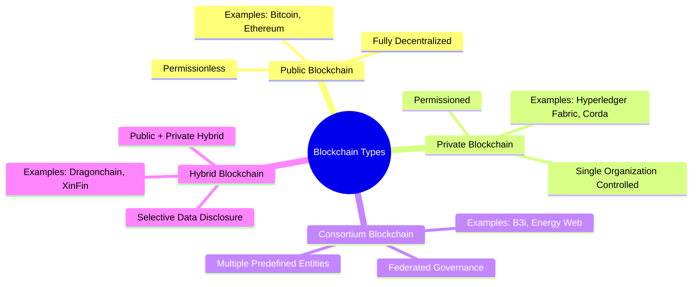
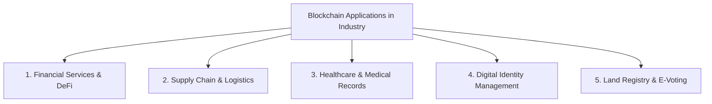
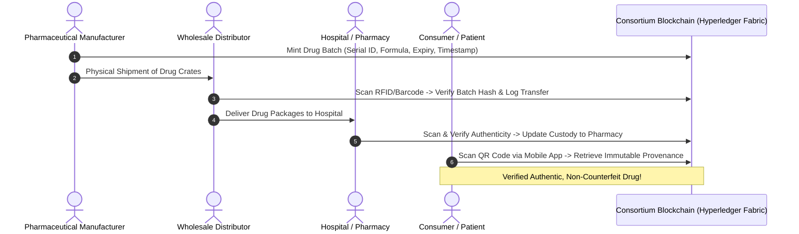

# Survey Report: Types of Blockchains and Real-Time Industry Use Cases

**Course:** Laboratory Practice - III (LP-III) | BE Computer Engineering (SPPU 2019 Pattern)  
**Subject:** Blockchain Technology (Group C - Assignment No: 5 / Mini Project)  
**Reference:** [Lab practice - III Lab Manual.pdf](file:///c:/Users/HEllo/practical/Lab%20practice%20-%20III%20Lab%20Manual.pdf) (Page 163)

---

## Executive Summary

Blockchain technology has transitioned from the underlying architecture of cryptocurrencies to a foundational paradigm for decentralized, tamper-proof enterprise data management. By eliminating single points of failure, establishing trust among untrusted entities, and guaranteeing algorithmic immutability through cryptographic hashing and distributed consensus, blockchain addresses longstanding challenges in security, transparency, and data reconciliation.

This survey report provides a comprehensive examination of blockchain systems as mandated by the Savitribai Phule Pune University (SPPU) LP-III curriculum:
1. **Introduction to Blockchain Architecture & Principles**
2. **Taxonomy & Comparative Analysis of Blockchain Types** (Public, Private, Consortium, and Hybrid)
3. **Cross-Industry Applications and Real-Time Use Cases**
4. **Detailed Case Study:** *Pharmaceutical Supply Chain & Drug Provenance via Consortium Blockchain*

---

## 1. Introduction to Blockchain

### 1.1 Origin and Evolution
Blockchain was formally introduced in 2008 by an anonymous author under the pseudonym **Satoshi Nakamoto** in the whitepaper *"Bitcoin: A Peer-to-Peer Electronic Cash System"*. While Bitcoin (Blockchain 1.0) was strictly focused on peer-to-peer electronic payments and digital currency transfer, Ethereum (Blockchain 2.0), introduced by Vitalik Buterin in 2015, revolutionized the landscape by integrating a Turing-complete virtual machine (EVM) that executes self-enforcing decentralized programs called **Smart Contracts**. Blockchain 3.0 and 4.0 now expand into enterprise scalability, cross-chain interoperability, and industrial Internet-of-Things (IoT) integrations.

### 1.2 Core Architectural Components
A blockchain is fundamentally a cryptographically linked, append-only distributed ledger distributed across peer-to-peer (P2P) nodes.

```mermaid
graph LR
    subgraph Block n-1
        H1["Block Hash: 000abc..."]
        PH1["Prev Hash: 000789..."]
        MR1["Merkle Root"]
        TX1["Transactions List"]
    end
    subgraph Block n
        H2["Block Hash: 000def..."]
        PH2["Prev Hash: 000abc..."]
        MR2["Merkle Root"]
        TX2["Transactions List"]
    end
    subgraph Block n+1
        H3["Block Hash: 000456..."]
        PH3["Prev Hash: 000def..."]
        MR3["Merkle Root"]
        TX3["Transactions List"]
    end
    Block n-1 --> Block n
    Block n --> Block n+1
```

1. **Block Header:** Contains metadata including the block version, timestamp, difficulty target, nonce, previous block hash, and the Merkle root.
2. **Cryptographic Hash Linkage (SHA-256 / Keccak-256):** Every block references the unique cryptographic hash of its predecessor. Any unauthorized change in a past block alters its hash and severs the cryptographic chain, making tampering immediately detectable.
3. **Merkle Trees:** Transactions within a block are paired and hashed recursively into a single root hash (the **Merkle Root**), allowing rapid $O(\log n)$ cryptographic verification of transaction integrity.
4. **Peer-to-Peer (P2P) Network:** Nodes maintain synchronized copies of the ledger using gossip protocols, eliminating centralized database servers.
5. **Consensus Mechanisms:** Algorithmic rules through which distributed nodes agree on a single source of truth without relying on a central authority:
   - **Proof of Work (PoW):** Computationally intensive mathematical puzzle solving (Bitcoin).
   - **Proof of Stake (PoS):** Energy-efficient block validation based on token stake (Ethereum 2.0).
   - **Practical Byzantine Fault Tolerance (PBFT) & Raft:** High-throughput voting-based consensus used in enterprise permissioned networks (Hyperledger Fabric).

---

## 2. Types of Blockchain

Blockchains are categorized according to their **governance structure**, **read/write permission levels**, and **node access criteria**.



---

### 2.1 Public Blockchain (Permissionless)
- **Definition:** A completely decentralized, open network where anyone can read the ledger, broadcast transactions, and participate in consensus without prior authorization.
- **Access Model:** Open to the global public (anonymous or pseudonymous).
- **Consensus:** Typically Proof of Work (PoW) or Proof of Stake (PoS).
- **Strengths:** Maximum censorship resistance, full transparency, no single point of trust or failure.
- **Weaknesses:** Lower transaction throughput (15–30 TPS on base layers), high transaction fees (Gas) during network congestion, high latency for block finality.
- **Real-World Examples:** **Bitcoin**, **Ethereum**, **Solana**, **Cardano**.

---

### 2.2 Private Blockchain (Permissioned)
- **Definition:** A blockchain strictly operated and governed by a single organization or enterprise. Read and write permissions are centrally granted to vetted participants.
- **Access Model:** Restricted; identity verification (KYC/X.509 certificates) is mandatory.
- **Consensus:** Crash Fault Tolerant (CFT) or BFT consensus algorithms such as Raft, Istanbul BFT (IBFT), or PBFT.
- **Strengths:** Extremely high throughput (thousands of TPS), sub-second latency, zero public gas fees, complete data privacy.
- **Weaknesses:** Centralized authority control; not censorship-resistant.
- **Real-World Examples:** **Hyperledger Fabric**, **R3 Corda**, **Multichain**, **J.P. Morgan's Quorum**.

---

### 2.3 Consortium / Federated Blockchain
- **Definition:** A collaborative multi-organizational blockchain governed by a pre-selected group of institutions rather than a single entity.
- **Access Model:** Federated; consensus nodes are distributed among verified stakeholder organizations (e.g., banks, shipping lines, or hospitals).
- **Consensus:** Multi-party PBFT, Raft, or Proof of Authority (PoA).
- **Strengths:** Shared operational governance without central dependency, high throughput, low operational costs, controlled access.
- **Weaknesses:** Requires complex inter-organizational governance agreements; colluding consortium members could theoretical tamper with historical records.
- **Real-World Examples:** 
  - **B3i:** Insurance industry consortium for reinsurance contract management.
  - **Energy Web Chain:** Consortium of global energy grid operators.
  - **We.Trade:** European bank consortium for trade finance settlement.

---

### 2.4 Hybrid Blockchain
- **Definition:** A dual-layer architecture combining public and private blockchain characteristics. Sensitive proprietary data is held within private state channels, while cryptographic transaction proofs are anchored to a public chain for external auditability.
- **Access Model:** Controlled; specific records are made publicly readable while operational business logic remains restricted.
- **Strengths:** Regulatory compliance (GDPR/HIPAA compatibility), protection of trade secrets with public proof-of-authenticity.
- **Weaknesses:** Increased architectural complexity and higher development overhead.
- **Real-World Examples:** **Dragonchain**, **XinFin (XDC Network)**.

---

### 2.5 Comparative Analysis Table

| Characteristic | Public Blockchain | Private Blockchain | Consortium Blockchain | Hybrid Blockchain |
| :--- | :--- | :--- | :--- | :--- |
| **Network Access** | Open to anyone (Permissionless) | Single Organization (Restricted) | Multiple Predefined Partners | Selective / Tiered |
| **Governance** | Decentralized Community | Centralized Organization | Distributed Consortium Board | Shared / Rule-Based |
| **Transaction Speed** | Low (7 – 35 TPS) | Very High (2,000 – 20,000+ TPS) | High (1,000 – 5,000 TPS) | High to Very High |
| **Latency / Finality** | Minutes to Hours | Milliseconds to Seconds | Seconds | Fast to Immediate |
| **Energy Usage** | Moderate to High | Negligible | Negligible | Very Low |
| **Identity / Privacy** | Pseudonymous / Public | Strict Identity (Known KYC) | Known Member Identities | Hybrid (Encrypted + Public Proof) |
| **Consensus Type** | PoW, PoS | Raft, PBFT, IBFT | PBFT, PoA, Raft | Dual / Layered |
| **Incentive Model** | Native Token / Mining Reward | No token required | Optional token / SLA-driven | Internal Token or Gas |

---

## 3. Real-Time Industry Applications of Blockchain



### 3.1 Financial Services & Decentralized Finance (DeFi)
- **Cross-Border Settlements:** Traditional SWIFT wire transfers take 3–5 business days and incur 3–7% intermediary fees. Blockchain networks (e.g., Ripple, Stellar) settle cross-border remittances in 3–5 seconds with near-zero transaction fees.
- **Automated Lending & Liquidity:** Smart contract protocols (Aave, Uniswap) allow automated collateralized lending, interest calculations, and token exchanges without commercial banking intermediaries.

### 3.2 Supply Chain Tracking & Cold Chain Logistics
- **Provenance Verification:** Raw materials, parts, and goods are tagged with serialized IoT/RFID sensors and logged on-chain at every transition (manufacturer $\rightarrow$ distributor $\rightarrow$ retailer).
- **Cold-Chain Assurance:** Perishable foods and vaccines have temperature logs captured by smart sensors; if temperature thresholds are breached, the smart contract automatically flags the shipment and pauses payment.

### 3.3 Healthcare Records & Clinical Trial Integrity
- **Electronic Health Records (EHR):** Patients control their medical history through cryptographic access keys, granting temporary read permissions to consulting physicians across different hospitals without central database leaks.
- **Clinical Trials:** Tamper-proof logging of trial participant outcomes prevents pharmaceutical data manipulation before regulatory submissions.

### 3.4 Self-Sovereign Digital Identity (SSI)
- Users hold decentralized identifiers (DIDs) in cryptographic mobile wallets. Users can prove specific credentials (e.g., being over 18 or holding an accredited university degree) using **Zero-Knowledge Proofs (ZKPs)** without revealing their date of birth, name, or address.

### 3.5 Governance, Land Registry & Auditable Elections
- **Land Title Registry:** Land registries in countries such as Georgia and Sweden record title transfers on a blockchain ledger, completely preventing illegal land grabbing, forged deeds, and administrative fraud.
- **E-Voting:** Cryptographically verifiable digital ballots prevent double-voting and ballot stuffing while maintaining ballot secrecy and auditable counts.

---

## 4. In-Depth Case Study: Blockchain in Pharmaceutical Supply Chain Traceability



### 4.1 Problem Statement
According to the World Health Organization (WHO), counterfeit pharmaceutical products account for an estimated **10% to 15% of all drugs worldwide**, resulting in hundreds of thousands of preventable deaths annually and over \$200 billion in illicit economic damage. Legacy pharmaceutical supply chains suffer from:
1. **Siloed Centralized Databases:** Manufacturers, logistics providers, wholesale distributors, and retail pharmacies maintain disconnected inventory systems with no shared ledger.
2. **Paper Documentation:** Counterfeiters routinely duplicate paper certificates of analysis and repackage expired medications.
3. **Slow Product Recalls:** Identifying compromised batches across disparate international distribution networks often takes weeks or months.

### 4.2 Proposed Consortium Blockchain Architecture
A consortium blockchain network implemented using **Hyperledger Fabric** brings together pharmaceutical manufacturers, national regulators (e.g., FDA / CDSCO), logistics carriers, distributors, and certified pharmacies.

#### Key Architectural Components:
1. **Network Nodes:**
   - **Endorsing Nodes:** Operated by pharmaceutical manufacturers and regulatory authorities to validate product minting transactions.
   - **Committing Nodes:** Hosted across logistics companies, warehouse distributors, and hospitals to maintain a synchronized ledger copy.
   - **Orderer Nodes:** Utilize Raft consensus to sequence valid transactions into deterministic blocks.
2. **Membership Service Provider (MSP):**
   - Implements PKI (Public Key Infrastructure) to authenticate and issue cryptographic X.509 digital certificates to all authorized supply chain actors.
3. **Smart Contract (Chaincode) Logic:**
   - `manufactureDrug(batchID, drugName, chemicalFormula, expiryDate, quantity)`
   - `transferCustody(batchID, senderID, recipientID, GPS_location, tempReading)`
   - `verifyAuthenticity(batchID, serialNumber)`
   - `triggerBatchRecall(batchID, reason)`

### 4.3 Execution Workflow
1. **Batch Minting:** The manufacturer packages medicines with unique 2D GS1 DataMatrix barcodes and cryptographically signs the batch creation transaction onto the blockchain ledger.
2. **Custodial Handshakes:** At each physical transit handoff (e.g., factory loading bay $\rightarrow$ cold storage truck $\rightarrow$ regional warehouse), both parties sign a digital custody transfer transaction. Real-time IoT temperature sensors automatically invoke chaincode; if temperature exceeds required thresholds (e.g., $2^\circ\text{C} - 8^\circ\text{C}$ for insulin), the batch is automatically flagged as spoiled.
3. **Point-of-Sale Verification:** The retail pharmacy scans the package serial number to confirm uninterrupted chain-of-custody.
4. **Consumer Scan:** The patient scans the box's QR code using a mobile smartphone app to verify the manufacturer's digital signature, production date, and genuine certification.

### 4.4 Quantitative Outcomes & Impact

| Metric | Traditional Legacy Supply Chain | Blockchain-Enabled Consortium |
| :--- | :--- | :--- |
| **Counterfeit Drug Penetration** | 8% – 15% Estimated | **0%** (Cryptographically signed end-to-end) |
| **Batch Recall Duration** | 7 to 45 business days | **Under 5 seconds** (Instantaneous global tracking) |
| **Provenance Verification Time** | Manual paperwork audit (Days) | **Immediate (< 2 seconds via QR scan)** |
| **Cold-Chain Temperature Audits** | Spot checks upon delivery | **Continuous real-time IoT smart contract alert** |
| **Data Tampering Vulnerability** | High (Single point of DB edit) | **Zero (Append-only distributed ledger)** |

---

## 5. Technical Challenges and Future Outlook

While blockchain offers transformative advantages, several critical engineering hurdles remain:
1. **The Blockchain Trilemma:** Formulated by Vitalik Buterin, stating that a decentralized system can achieve at most two of three properties simultaneously: **Decentralization**, **Security**, and **Scalability**. Modern Layer-2 rollups (Zero-Knowledge Rollups, Optimistic Rollups) and sharding aim to alleviate these constraints.
2. **Interoperability Standards:** Siloed blockchain networks (e.g., Ethereum vs. Hyperledger vs. Corda) require cross-chain bridge protocols (such as Polkadot and Cosmos) to exchange verified data seamlessly.
3. **Post-Quantum Cryptography:** Current blockchains rely heavily on elliptic curve cryptography (ECDSA `secp256k1`) and RSA, which are vulnerable to Shor's algorithm on quantum computers. Transitioning to lattice-based post-quantum cryptographic primitives is an active research area.
4. **Regulatory and Legal Recognition:** Smart contracts must harmonize with international commercial law, consumer rights, and data privacy mandates (such as the GDPR *"Right to be Forgotten"*, which conflicts with immutable ledgers).

---

## 6. Conclusion

Blockchain has evolved beyond speculative cryptocurrencies to become a foundational technology for trustworthy computing in multi-party enterprise environments. As demonstrated in this survey:
- **Public blockchains** excel at censorship-resistant, decentralized financial systems.
- **Private and Consortium blockchains** (e.g., Hyperledger Fabric) provide the privacy, high throughput, zero gas costs, and regulatory compliance essential for corporate and industrial infrastructure.
- In critical sectors such as **pharmaceutical supply chains**, blockchain replaces vulnerable paper trails and siloed databases with an immutable, cryptographically verifiable record of authenticity that saves lives and prevents fraud.

---

## 7. References and Standards

1. Nakamoto, S. (2008). *Bitcoin: A Peer-to-Peer Electronic Cash System.* [https://bitcoin.org/bitcoin.pdf](https://bitcoin.org/bitcoin.pdf)
2. Buterin, V. (2014). *Ethereum: A Next-Generation Smart Contract and Decentralized Application Platform.* [https://ethereum.org/en/whitepaper/](https://ethereum.org/en/whitepaper/)
3. Androulaki, E., et al. (2018). *Hyperledger Fabric: A Distributed Operating System for Permissioned Blockchains.* In Proceedings of the Thirteenth EuroSys Conference (EuroSys '18).
4. Savitribai Phule Pune University (SPPU). *BE Computer Engineering Curriculum: Laboratory Practice - III (Course Code: 410246).*
5. IEEE Standards Association. *IEEE 2418.1-2021 - IEEE Standard for Framework of Blockchain Systems in Supply Chain Management.*
